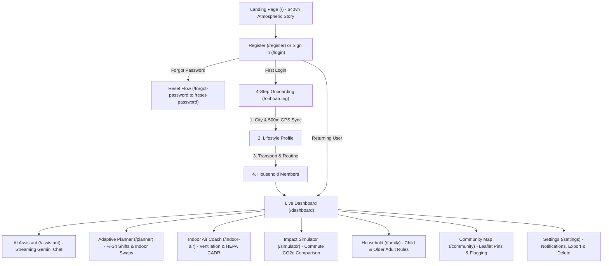
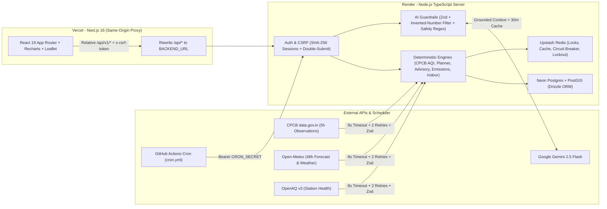

<div align="center">

# 🌿 AERIQ — *Intelligence for Every Breath*

**Personal urban air-quality intelligence, deterministic CPCB NAQI scoring, adaptive daily planning, and Gemini-powered guidance.**

[](https://nextjs.org/)
[](https://react.dev/)
[](https://www.typescriptlang.org/)
[](https://nodejs.org/)
[](https://neon.tech/)
[](https://upstash.com/)
[](https://ai.google.dev/)
[](https://vitest.dev/)

</div>

---

## ✨ What is AERIQ?

Most air-quality apps stop at showing a single number. **AERIQ** turns live, timestamped pollution readings into concrete, everyday decisions tailored to your **city, commute mode, daily routine, and household** (including children and older adults).

Built on one strict principle:
> 🟢 **Deterministic code** computes every AQI score, CO₂e emission, purifier CADR, and schedule shift.  
> 🟣 **Google Gemini (`gemini-2.5-flash`)** explains only validated, grounded numbers — never inventing a reading.

---

## 🎨 CPCB NAQI Scale & Advisory Bands

| AQI Range | Category | Badge | Household & Planner Behavior |
| :---: | :--- | :---: | :--- |
| **0 – 50** | Good | 🟢 `good` | Outdoor activities & cross-ventilation encouraged |
| **51 – 100** | Satisfactory | 🟡 `satisfactory` | Normal outdoor routines; mild awareness |
| **101 – 200** | Moderate | 🟠 `moderate` | Planner shifts flexible hours; **child / older adult** households swap indoors |
| **201 – 300** | Poor | 🔴 `poor` | Flexible activities swapped to indoor alternatives; windows closed |
| **301 – 400** | Very Poor | 🟣 `very_poor` | High-exertion outdoor exercise moved indoors; HEPA & exhaust guidance |
| **401 – 500** | Severe | 🟤 `severe` | Strict indoor stay, sealed street-facing windows, transit precautions |

---

## 🗺️ Visual User Flow



---

## ⚙️ Technical Architecture & Data Flow



### 🔄 Core Pipelines
1. **Same-Origin Security:** Browser requests hit `/api/v1/*` on Vercel, rewritten server-side to `BACKEND_URL`. Sessions use 32-byte random IDs (SHA-256 hashed in `sessions`), `HttpOnly; SameSite=Lax`, 30-day sliding expiry, and double-submit `x-csrf-token` + `Origin` validation.
2. **5-Hour AQI Ingestion & Auto-Refresh:** `.github/workflows/cron.yml` triggers `POST /api/cron/ingest-observations` every 5 hours (`0 */5 * * *`), protected by Redis `SET NX EX 600` locks, normalizes CPCB `µg/m³` -> `CO mg/m³`, computes `cpcb-naqi-2014.1` snapshots, flushes `aqi:current:*` in Redis, and `/dashboard` auto-refreshes every 5 hours.
3. **Deterministic Advisory + Gemini Explanation:** `/api/v1/aqi/current` evaluates `advisory.ts` (`category × freshness × lifestyle × ageGroup × activity`) instantly; `/api/v1/assistant/recommend` and `/api/v1/assistant/chat` pass those validated facts to Gemini and reject any hallucinated numbers via `findInventedNumber()`.

---

## 📁 Project File Structure

```text
AERIQ/
├── .github/workflows/
│   ├── ci.yml                      # Frontend typecheck/lint/build + Backend tsc & Vitest
│   ├── cd.yml                      # Vercel deploy + Drizzle migrate + Render deploy hook
│   └── cron.yml                    # Scheduled health/live (10m) & 5h AQI ingestion jobs
│
├── frontend/                       # Next.js 16 + React 19 + Tailwind v4 (Vercel)
│   ├── next.config.ts              # Same-origin /api/:path* -> BACKEND_URL rewrite
│   ├── public/images/landing/      # Custom editorial landing page visuals
│   └── src/
│       ├── app/
│       │   ├── (marketing)/        # Landing page (/) with 640vh scroll story
│       │   ├── (auth)/             # /login, /register, /forgot-password, /reset-password
│       │   ├── onboarding/         # 4-step setup wizard (/onboarding)
│       │   ├── (dashboard)/        # /dashboard, /assistant, /planner, /family,
│       │   │                       # /indoor-air, /simulator, /community, /settings
│       │   └── dev/                # /dev/gemini-usage, /dev/kit
│       ├── components/
│       │   ├── auth/               # AuthSplitShell
│       │   ├── charts/             # AqiAreaChart (Recharts observed + forecast)
│       │   ├── community/          # LeafletMap (stations + ~500m rounded pins)
│       │   ├── landing/            # WhyAeriq, InsideTheApp, HowItWorks, ClosingCta
│       │   ├── layout/             # TopBar, Rail, MobileTabBar, PageHero, Panel
│       │   └── ui-aeriq/           # GlassCard, TiltCard, AqiBadge, Sparkline, Hotspot
│       ├── hooks/                  # useLiveLocation, useRafScroll, useCountUp, useInView
│       └── lib/                    # api.ts (30s timeout + CSRF), sentry.ts, format.ts
│
└── backend/                        # Node.js TypeScript HTTP Server (Render)
    ├── drizzle/                    # Versioned SQL migrations + meta/_journal.json
    ├── src/
    │   ├── contracts/              # Shared Zod request/response schemas
    │   ├── db/                     # Drizzle schema (25 tables + PostGIS) & seed.ts
    │   └── server/
    │       ├── ai/                 # gemini.ts, context.ts, prompts.ts, safety.ts
    │       ├── cron/               # Redis-locked cron jobs (ingest, smart refresh, cleanup)
    │       ├── engines/            # aqi.ts, advisory.ts, planner.ts, indoor.ts,
    │       │                       # emissions.ts, exposure.ts, freshness.ts
    │       ├── http/               # router.ts (REST + SSE + CSRF + security headers)
    │       ├── lib/                # privacy.ts, redis.ts, envelope.ts, sentry.ts
    │       ├── providers/          # http.ts (circuit breaker) + cpcb, openaq, openmeteo
    │       └── services/           # Business logic & ownership-scoped DB queries
    └── tests/                      # Vitest unit, hardening, & supertest API suites
```

---

## 🛠️ Local Setup & Verification

### 1. Environment Variables
Copy the templates and fill in your keys (never commit `.env` files):
```bash
cp backend/.env.example backend/.env
cp frontend/.env.example frontend/.env.local
```

### 2. Run Backend & Frontend
```bash
# Terminal 1 — Backend (http://localhost:4000)
cd backend
npm install
npx drizzle-kit migrate
npm run db:seed
npm run dev

# Terminal 2 — Frontend (http://localhost:3000)
cd frontend
npm install
npm run dev
```

### 3. Run Checks & Tests
```bash
# Backend typecheck & Vitest suite
cd backend && npm run build && npm test

# Frontend typecheck, lint & production build
cd frontend && npx tsc --noEmit && npm run lint && npm run build
```

---

## 🌱 Built with Care for Everyday Decisions

AERIQ bridges the gap between raw environmental telemetry and daily life — combining **CPCB & Open-Meteo data**, **PostGIS spatial privacy**, **Redis-backed resilience**, and **strictly grounded Gemini AI** into a calm, fast, actionable companion for students, commuters, and families.
